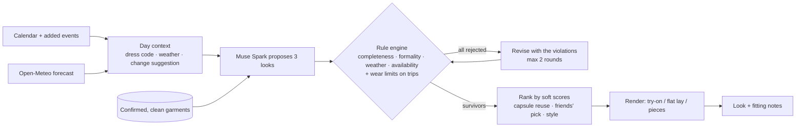

# Wardrobe Stylist

Film your closet once. Each morning, get one outfit that fits your calendar, the weather and what's actually clean. When you travel, get a packing list that won't run you out of shirts.

Built for Meta's Global AI Developer Hackathon (track: **Build for Your World**).

> **All code in this repository was written during the hackathon, 27 Oct – 4 Nov 2026.** The design docs in `docs/` (spec, UI style guide, plan) were written on 26 Oct, before the build window. The commit history shows one commit per planned task.

## What it does

- **Closet scan.** Pan your phone across the closet, hold pieces up one at a time, or take a photo.
  - Each garment comes back as a cutout with tags: category, colors, how formal, how warm, rain-safe.
  - Duplicates are merged, and nothing is used until you confirm it.
- **Today.** One look for the day, built from:
  - your calendar, which sets the dress code;
  - the forecast at the place you'll actually be;
  - only clothes that are clean.

  Each piece says why it's there. *Fitting notes* show the checks that ran, plus anything the stylist swapped on the way (*"↺ Swapped suede loafers → boots — 80% rain"*). Then it asks: *"Anything today that's not on your calendar?"*
- **Show it your way.** Try-on (on a photo of you), flat lay, or just the pieces. If rendering fails, it falls back to the pieces and never blocks the outfit.
- **Trips.** A look for every day and a packing checklist. It respects how often *you* rewear each kind of clothing: t-shirts once, jeans five times, all editable. If the closet can't cover the trip, it says exactly what's short.
- **Talk to it.** Hold the mic: "drinks after work", "pack for Chicago Thursday to Sunday". The agent calls the same planner, so the rules still apply.
- **One piece to add.** It computes how many new outfits a single purchase would make possible across a smart day, a rainy day and a cold day.
- **Stretch goals:**
  - *Which look?* — share a link, friends vote, wear the winner.
  - *Your style* — screenshots of outfits you like become an editable style profile that nudges choices.

## Meta models

| Job | Model | Where |
|---|---|---|
| Find each garment in a closet video or photo | **SAM 3.1** (`sam-3-1`) | `src/lib/models/*/segmenter` |
| Tag cutouts; propose and revise outfits; classify events; chat agent; product search | **Muse Spark** (`muse-spark-1.3`) | `tagger`, `stylist`, `chat` |
| Try-on and flat-lay renders | **Muse Image** | `renderer` |
| Voice input | **Muse Voice Transcribe** (`muse-voice-transcribe-1.0`) | `transcriber` |

Every model call goes through one of these adapters in `src/lib/models/`. Each adapter has a real implementation and a mock, selected with `MODELS=real|mock`. The mocks need no keys and make no network calls, so the whole app runs offline. The real Meta adapters are the next task, once API credits arrive.

## How an outfit gets picked

The model proposes; the code decides.



- **Rules are small pure functions** (`src/lib/rules/`). Hard rules reject a look; soft rules only rank. Anything the model returns that doesn't parse, or that names a garment you don't own, counts as a violation.
- **If nothing passes after two revisions**, you get the closest look and an honest note, not a crash.
- **Trips** plan day by day and carry wear counts forward, with renders off.
- **The chat agent** (`src/lib/agent/`) can only reach clothes through tools such as `plan_outfit` and `plan_trip`; it never picks garments itself.

## Run it

Requires Node 20 or newer.

```bash
cp .env.example .env.local
```

```bash
npm install
```

```bash
npm run dev
```

In `.env.local`, `MODELS=mock` works with no keys. Set `DEV_USER_EMAIL` to sign in without Google during development. On an empty closet, *Load the sample closet* gives you twelve pieces to try.

| Setting | Needed for |
|---|---|
| `AUTH_SECRET`, `AUTH_GOOGLE_ID`, `AUTH_GOOGLE_SECRET` | Google sign-in and calendar. The scope is `calendar.readonly`. |
| `SUPABASE_URL`, `SUPABASE_SERVICE_ROLE_KEY` | Postgres and storage (`supabase/migrations/0001_init.sql`). Without them, data lives in `.data/`. |
| `MODELS=real`, `META_API_BASE_URL`, `META_API_KEY` | The Meta Model API |
| `NEXT_PUBLIC_FEATURE_POLL=1`, `NEXT_PUBLIC_FEATURE_STYLE=1` | The stretch features |

## Tests

```bash
npm test
```

```bash
npx playwright install chromium
```

```bash
npm run test:e2e
```

```bash
npm run check:slop
```

- `npm test`: unit tests for rules, the outfit loop, trips, gaps, scan, agent and repo.
- `npm run test:e2e`: browser tests in mock mode, including the demo walkthrough in `tests/e2e/demo.spec.ts`.
- `npm run check:slop`: a grep for the UI style guide's banned patterns.

## Stack

Next.js 15 (App Router) · React 19 · TypeScript (strict) · Tailwind CSS 4 with design tokens only · Zod · sharp · Auth.js · Supabase · Open-Meteo · Vitest · Playwright.

Visual rules: [`docs/ui-style-guide.md`](docs/ui-style-guide.md) — "The Lookbook".
Design: [`docs/superpowers/specs/2026-10-26-wardrobe-stylist-design.md`](docs/superpowers/specs/2026-10-26-wardrobe-stylist-design.md).
