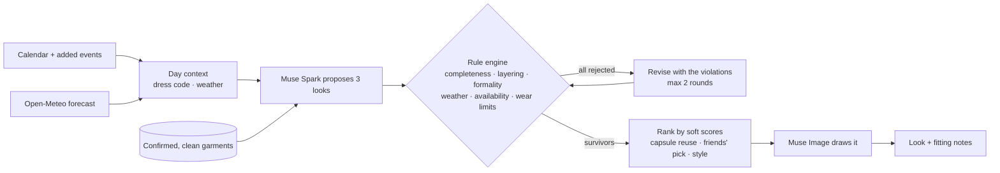

# Wardrobe Stylist

**A stylist you can text, who knows every piece in your closet.** Add your clothes once, by filming the rail or holding pieces up. Each morning you get one outfit that fits your calendar, the weather and what's actually clean, in the app or on WhatsApp. When you travel, you get a packing list that won't run you out of shirts.

**Try it:** [www.wardrobe-stylist.xyz](https://www.wardrobe-stylist.xyz). Tap **Try the demo**; no account needed. You get your own copy of a real closet and a sample calendar.

Built for Meta's Global AI Developer Hackathon (track: **Build for Your World**).

> **All code in this repository was written during the hackathon, 27 Oct – 4 Nov 2026.** The design docs in `docs/` (spec, UI style guide, plan) were written on 26 Oct, before the build window.

## The problem

I own plenty of clothes and still wear the same few things. Every morning is a decision made without knowing what the day holds, and packing for a trip is the same problem multiplied by every day away. A stylist would fix that, but a stylist has to know your closet, your week and your laundry. This one does.

## What it does

**Scan your closet once.** Pan your phone across the rail, hold pieces up one at a time, or take a photo.
- **SAM 3.1** finds each garment, and **Muse Spark** tags it: category, colours, how formal, how warm, rain-safe, brand and fit.
- Duplicates are merged, and nothing is used until you confirm it.
- Missing something? Find it online by name and add it with the store's photo.

**Text your stylist.** One saved conversation, in the app and on WhatsApp; both show the same thread.
- *"Something for drinks after work"* gets a look, then its picture.
- Swipe-reply to a look to swap a piece. *"I spilled coffee on the white shirt"* sends it to the laundry.
- *"I wore the navy polo and jeans today"* logs the wear. Pieces at their limit go to the laundry, and the next look won't use them.
- Send a photo to add the clothes in it, to ask *"how do I look?"*, or to say *"match this look"* from a picture you like.
- It remembers what you tell it (*"I never wear navy with black"*) and sends one look each morning without being asked.

**Today.** One look for the day, built from:
- your calendar, which sets the dress code;
- the forecast where you'll actually be;
- only clothes that are clean.

Each piece says why it's there. *Fitting notes* show the checks that ran and anything the stylist changed on the way (*"↺ Swapped suede loafers → boots — 80% rain"*).

**See it your way.** On a photo of you, on a mannequin, as a flat lay, or just the pieces. If drawing fails, you get the pieces; the look is never blocked.

**Trips.** A look for every day and a packing checklist. It respects how often *you* rewear each kind of clothing (t-shirts once, jeans five times, all editable). If the closet can't cover the trip, it says exactly what's short.

**One piece to buy.** It works out how many new outfits a single purchase would unlock across a smart day, a rainy day and a cold day.

**Extras:** *Which look?* sends a link where friends vote and you wear the winner. *Your style* turns screenshots of outfits you like into a style profile that nudges choices.

## Meta models and platforms

| Job | Meta model or platform |
|---|---|
| Find each garment in a closet video or photo | **SAM 3.1** |
| Tag pieces; propose and revise outfits; read the calendar; run the stylist agent and its tools; read photos | **Muse Spark** |
| Draw the look: try-on, mannequin, flat lay | **Muse Image** |
| Hold-to-talk voice messages | **Muse Voice Transcribe** |
| Text the stylist, with read receipts, typing dots, buttons and pictures | **WhatsApp Cloud API** |

Every model call goes through one adapter in `src/lib/models/` (`segmenter`, `tagger`, `stylist`, `chat`, `renderer`, `transcriber`). Each has a real implementation and a mock, picked with `MODELS=real|mock`; the mocks need no keys and no network, so the whole app runs offline. How SAM is called, and how it did on real scans: [`docs/notes/sam-check.md`](docs/notes/sam-check.md).

## How an outfit gets picked

**The model proposes; the code decides.**



- **Rules are small pure functions** (`src/lib/rules/`). Hard rules reject a look, and soft rules only rank. A model answer that doesn't parse, or that names a garment you don't own, counts as a violation.
- **Layering is checked, not hoped for.** A tee or polo, then a shirt, then a knit, then a coat; never two polos at once. The picture prompt names every piece, its colour and what goes over what.
- **If nothing passes after two revisions**, you get the closest look and an honest note, not a crash.
- **The stylist agent** (`src/lib/agent/`) reaches your clothes only through tools such as `plan_outfit`, `swap_piece`, `log_wear` and `plan_trip`. It never picks garments itself, so the rules hold in chat and on WhatsApp too.
- **On WhatsApp, the look goes out first** and its picture follows when it's drawn, so a reply never waits on the image.
- **Every picture is checked before anyone sees it.** The code checks the framing, and Muse Spark checks that each piece appears exactly once in the right colour. A picture that's cut off or misses a piece is drawn once more, and the better one is kept.

## Run it

Requires Node 20 or newer.

```bash
cp .env.example .env.local
```

```bash
npm install
```

```bash
npm run dev
```

`MODELS=mock` works with no keys. Set `DEV_USER_EMAIL` to sign in without Google during development. On an empty closet, *Load the sample closet* gives you twelve pieces to try.

| Setting | Needed for |
|---|---|
| `AUTH_SECRET`, `AUTH_GOOGLE_ID`, `AUTH_GOOGLE_SECRET` | Google sign-in and calendar (scope `calendar.readonly`; nothing is written back) |
| `SUPABASE_URL`, `SUPABASE_SECRET_KEY` | Postgres and storage (`supabase/migrations/`). Without them, data lives in `.data/`. |
| `MODELS=real`, `META_API_BASE_URL`, `META_API_KEY` | The Meta models |
| `WHATSAPP_TOKEN`, `WHATSAPP_PHONE_ID`, `WHATSAPP_APP_SECRET`, `WHATSAPP_VERIFY_TOKEN`, `WHATSAPP_DISPLAY_NUMBER`, `WHATSAPP_TEMPLATE` | Texting on WhatsApp ([setup](docs/notes/whatsapp-setup.md)) |
| `CRON_SECRET` | The morning note |
| `SERPAPI_KEY` | Finding pieces online |
| `DEMO_SOURCE_USER` | *Try the demo*: whose confirmed closet demo visitors get a copy of |
| `NEXT_PUBLIC_FEATURE_POLL=1`, `NEXT_PUBLIC_FEATURE_STYLE=1` | The extras |

WhatsApp runs on Meta's test number, which only messages numbers added to the app, so it's shown in the demo video rather than open to everyone.

## Tests

```bash
npm test
```

```bash
npx playwright install chromium
```

```bash
npm run test:e2e
```

```bash
npm run check:slop
```

- `npm test`: unit tests for the rules, the outfit loop, layering, trips, gaps, scan, the agent and its tools, WhatsApp, the picture prompts and the repo.
- `npm run test:e2e`: browser tests in mock mode, including the demo walkthrough (`tests/e2e/demo.spec.ts`) and *Try the demo*.
- `npm run check:slop`: a check for the UI style guide's banned patterns.
- Live checks cost money or touch your project, so they run only when asked:
  - `META_CONTRACT=1 npx vitest run tests/models/real.contract.test.ts` calls each Meta model once.
  - `SUPABASE_CONTRACT=1 npx vitest run tests/db/repo.test.ts` runs the repo tests against your Supabase project as throwaway test users, deleting their rows before and after.
  - `MODELS=real npx tsx --tsconfig tsconfig.json scripts/render-bench.mts <label> [runs]` draws the same looks a few times and counts what's wrong with each picture (cut off, a piece missing or doubled, a wrong colour, label lettering), so a change to the picture prompt is measured. `BENCH_USER=<id>` uses that user's newest looks, read-only.

## Stack

Next.js 16 (App Router) · React 19 · TypeScript (strict) · Tailwind CSS 4 with design tokens only · Zod · sharp · Auth.js · Supabase · Open-Meteo · SerpApi · Vitest · Playwright · Vercel.

Visual rules: [`docs/ui-style-guide.md`](docs/ui-style-guide.md) — "The Lookbook".
Design: [the main spec](docs/superpowers/specs/2026-10-26-wardrobe-stylist-design.md) and [the stylist thread](docs/superpowers/specs/2026-10-30-stylist-thread-design.md).
